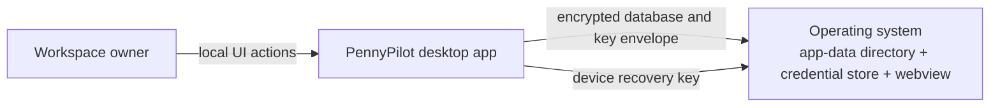
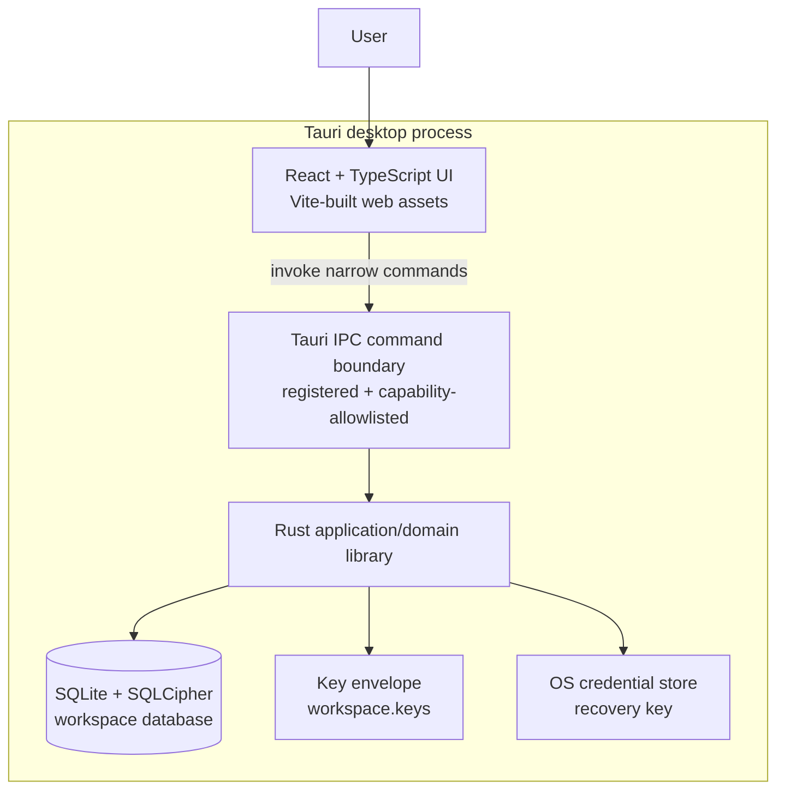
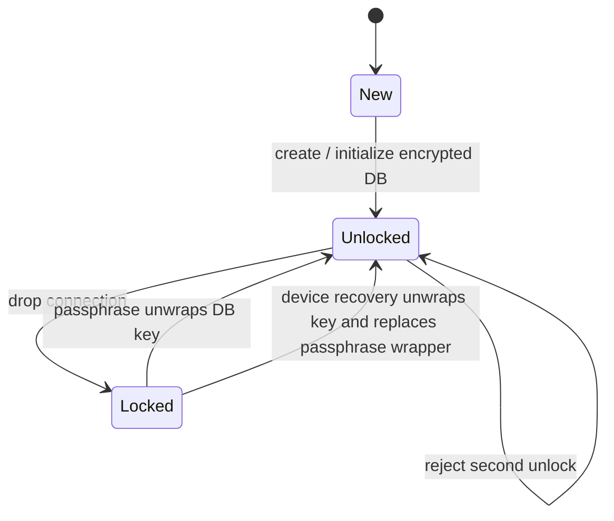
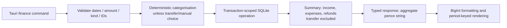
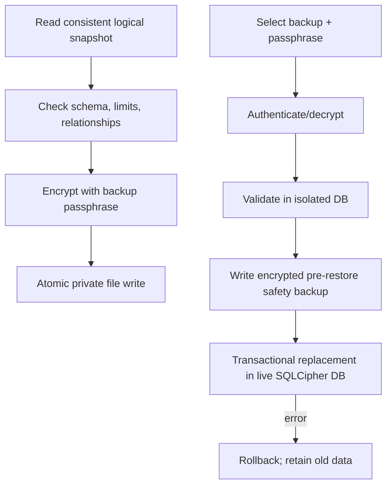
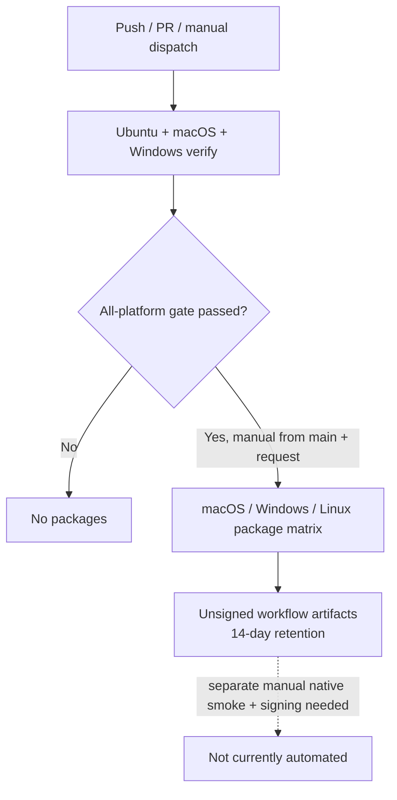

# PennyPilot Software Architecture Document

**Status:** Describes the implementation in the documentation branch as reviewed on 2026-10-13.

**Product version:** `0.1.0`

**System type:** Local-first desktop application
**Last reviewed:** 2026-10-13

This document is grounded in files in this repository. Paths in citations are relative to the repository root. “Implemented” denotes behavior present in the code; “planned” denotes absent behavior. Hosting-provider settings that are not represented in source are marked unverified.

## 1. Purpose and scope

This SAD explains the system context, architecture, data/security boundaries, key user flows, development and deployment paths, and known risks for PennyPilot. It is intended for maintainers, reviewers, and new contributors. It does not specify a cloud service: this checkout implements a native desktop app with local persistence. The [README](../../README.md) remains the user-facing product and financial-contract reference.

### Checkout identity

| Field | Inspected value |
| --- | --- |
| Configured `origin` | `https://github.com/ahsansabir30/pennypilot.git`; no GitLab remote was configured. |
| Documentation branch | `docs/update-project-documentation-and-sad` |
| Code baseline before this documentation work | `2ce729d` |
| Product version | `0.1.0` in the package and Tauri manifests. |
| License | No root `LICENSE` file was present in the inspected tree. |

## 2. System overview

PennyPilot is a UK personal-finance desktop app built with Tauri 2. A React/TypeScript frontend renders the interface, while a Rust library owns workspace encryption, credential recovery, validation, finance rules, and SQLite operations. Frontend requests cross the Tauri IPC bridge using explicit commands. The data store is a SQLCipher-enabled SQLite database under the OS application-data directory. No remote finance API, bank connection, cloud sync, or telemetry is implemented.

### Business context

The product helps an individual record and review financial activity privately on one device. Implemented workflows include transaction management, category/rule maintenance, budgets, manually maintained savings goals, local CSV export, and independently encrypted backup/restore. CSV import, user-managed accounts, and recurring/subscription detection are planned and must not be represented as available features.

### Key users

- **Workspace owner:** creates, unlocks, locks, recovers, and backs up a local workspace.
- **Maintainer/developer:** builds, tests, reviews, and packages the desktop application.
- **Reviewer/release maintainer:** validates changes and controls package distribution. The current workflow offers a pre-run package-request input, not a separate post-check reviewer approval.

### Quality attributes

| Attribute | Architectural response |
| --- | --- |
| Confidentiality | SQLCipher database; random database key wrapped by passphrase and device recovery keys; files remain local; strict webview CSP and narrow Tauri commands. |
| Financial correctness | Rust validation and SQL constraints; integer pence; explicit transaction kinds; BigInt frontend aggregate math; tested date and overflow boundaries. |
| Integrity/recoverability | Transactional schema changes and restore; authenticated backup encryption; required pre-restore safety backup; atomic file writes. |
| Usability | Dedicated pages, accessible dialogs/navigation, loading/error/retry states, responsive desktop/mobile browser layouts, theme preference. |
| Portability | Tauri packages native macOS, Windows, and Linux application formats; system webview and platform credential store vary by OS. |
| Maintainability | React components and Rust finance modules separated by responsibility; pinned lockfiles; Vitest, Rust, Playwright, ESLint, TypeScript, Clippy, and CI. |
| Privacy | No service backend, external finance integrations, telemetry, or network data sync. Browser tests use fictional data. |

### Architecture goals and constraints

1. Keep financial rules, validation, persistence, and key handling in Rust.
2. Expose only narrow, explicit commands to the React UI.
3. Keep private data under application data, not the source repository.
4. Preserve GBP accounting invariants and reject invalid/overflowing data rather than silently coercing it.
5. Avoid introducing a server, network integration, competing frontend framework, or third-party telemetry without a separate requirement.

## 3. Technology stack

| Layer | Technology | Evidence |
| --- | --- | --- |
| Desktop shell / IPC | Tauri 2 | [`src-tauri/Cargo.toml`](../../src-tauri/Cargo.toml#L17-L21), [`src-tauri/tauri.conf.json`](../../src-tauri/tauri.conf.json#L1-L10) |
| Frontend | React 19, TypeScript, Vite 8 | [`package.json`](../../package.json#L16-L38), [`src/main.tsx`](../../src/main.tsx#L1-L10), [`vite.config.ts`](../../vite.config.ts#L1-L24) |
| Backend/domain | Rust 2021 | [`src-tauri/Cargo.toml`](../../src-tauri/Cargo.toml#L1-L15), [`src-tauri/src/lib.rs`](../../src-tauri/src/lib.rs#L1-L16) |
| Persistence | rusqlite + bundled SQLCipher | [`src-tauri/Cargo.toml`](../../src-tauri/Cargo.toml#L29-L32), [`.cargo/config.toml`](../../.cargo/config.toml#L1-L2) |
| Workspace crypto | Argon2id, XChaCha20-Poly1305, getrandom, zeroize | [`src-tauri/Cargo.toml`](../../src-tauri/Cargo.toml#L24-L31), [`src-tauri/src/lib.rs`](../../src-tauri/src/lib.rs#L8-L16) |
| Device recovery | OS keyring via `keyring` crate | [`src-tauri/Cargo.toml`](../../src-tauri/Cargo.toml#L29-L32), [`src-tauri/src/lib.rs`](../../src-tauri/src/lib.rs#L70-L96) |
| Frontend tests | Vitest, Testing Library, jsdom | [`package.json`](../../package.json#L21-L38), [`vite.config.ts`](../../vite.config.ts#L1-L12) |
| Browser interaction tests | Playwright | [`package.json`](../../package.json#L6-L14), [`playwright.config.ts`](../../playwright.config.ts#L1-L25), [`e2e/fixtures.ts`](../../e2e/fixtures.ts#L1-L30) |
| CI | GitHub Actions; cross-platform verify and gated manual packages | [`.github/workflows/ci.yml`](../../.github/workflows/ci.yml#L1-L18), [verify job](../../.github/workflows/ci.yml#L29-L79), [package job](../../.github/workflows/ci.yml#L81-L153) |

Dependency manifests use semver ranges in `package.json` and `Cargo.toml`; committed `package-lock.json` and `src-tauri/Cargo.lock` lock exact resolution. Node 24 and Rust stable are the documented/CI toolchains. There is no root license file, app server, Docker image, database service, or GitLab pipeline in the inspected tree.

### Commands and verification inventory

| Command/workflow | Purpose and evidence |
| --- | --- |
| `npm run tauri dev` | Native development app; declared in [`package.json`](../../package.json#L6-L14) and connected to Vite by [`tauri.conf.json`](../../src-tauri/tauri.conf.json#L6-L10). |
| `npm run lint`, `npm run typecheck`, `npm test`, `npm run test:e2e`, `npm run build` | Frontend checks/build; scripts in [`package.json`](../../package.json#L6-L14). |
| `cargo fmt`, `cargo clippy`, `cargo test` | Rust format, lint, and test commands in [`scripts/verify.sh`](../../scripts/verify.sh#L32-L42). |
| `npm run tauri build` | Native host bundle build in [`package.json`](../../package.json#L6-L14) / package job. |
| `./scripts/verify.sh` | Full local gate, called by CI; [`scripts/verify.sh`](../../scripts/verify.sh#L1-L42), [CI verify job](../../.github/workflows/ci.yml#L29-L79). |
| GitHub Actions `CI` | Pushes, pull requests to `main`, and manual dispatch in [workflow triggers](../../.github/workflows/ci.yml#L1-L27); default verification matrix is Ubuntu/macOS/Windows. |
| Package matrix | Manual all-platform dispatch from `main`, after `verify` succeeds; [package job](../../.github/workflows/ci.yml#L81-L155). |
| CI enforcement | Workflow runs are configured in source, but required status checks/protected-branch rules are platform settings and are **not verified by this checkout**. |

For focused commands and test caveats, see the [developer command inventory](../development.md#command-inventory).

### Repository layout and runtime lifecycle

`src/` contains React/TypeScript UI and unit tests; `e2e/` contains Playwright tests/harness; `src-tauri/src/` contains the Rust app and finance modules; `src-tauri/capabilities/`, `permissions/`, and `tauri.conf.json` define native access/build behavior; `public/` contains static assets; `scripts/` contains verification/publishing helpers; `.github/workflows/` contains GitHub Actions.

No container base image, compose topology, serverless runtime, or separately provisioned datastore exists. Build runtimes are CI runner labels (`ubuntu-latest`, `macos-latest`, `windows-latest`), Node 24, and the floating Rust stable channel. The installed app runs on each OS's native webview/credential store; SQLCipher is bundled rather than hosted. The OS runner and stable toolchain labels are intentionally not exact patch pins.

No formal third-party end-of-life audit was performed. The manifests do not mark a dependency as deprecated; lifecycle/support status is therefore **unverified**, not certified. Review advisories and upstream support during routine dependency updates.

## 4. High-level architecture

### C4 Level 1 — System context



### C4 Level 2 — Containers



### C4 Level 3 — Representative dashboard request

```mermaid
sequenceDiagram
    actor User
    participant UI as Dashboard.tsx
    participant IPC as Tauri invoke
    participant Rust as Rust finance command
    participant DB as SQLCipher SQLite
    User->>UI: Select month / open page
    UI->>IPC: list_finance_data(month)
    IPC->>Rust: Deserialize command arguments
    Rust->>Rust: Require unlocked connection; validate requested month
    Rust->>DB: Query summaries/categories/accounts
    DB-->>Rust: Persisted rows and integer aggregates
    Rust-->>IPC: Typed response (aggregate pence as decimal strings)
    IPC-->>UI: Promise result
    UI->>UI: Key response by month/revision; format using BigInt
    UI-->>User: Render current-period results or explicit error/retry
```

## 5. Component architecture

### Frontend

`src/main.tsx` initializes theme and mounts React. `src/App.tsx` handles workspace status, create/unlock/recovery/lock, and the non-Tauri browser guard. `src/navigation.ts` provides dependency-free hash routing. `src/Dashboard.tsx` owns shared page state, finance queries, filters, transaction mutations, and routes to focused page components. Styling is co-located in CSS files; dialogs use the shared `src/Modal.tsx`.

The six pages are Overview, Transactions, Budgets, Savings, Categories & Rules, and Export & Backup. The app renders finance data only after unlock; it hides stale results when the requested month/filter/revision changes. Frontend calculations use integer inputs and BigInt for aggregate values, with floating point limited to visual proportions.

The browser webview is configured with a restrictive CSP and frozen prototype. The app does not use a general-purpose client router or browser SQL/database library. Hash routes are canonicalized by `src/navigation.ts`.

### Backend and API boundary

There is no HTTP API or separately deployed backend. `src-tauri/src/lib.rs` is the Tauri library entry point; `src-tauri/src/main.rs` calls `pennypilot_lib::run()`. Commands are grouped under workspace and finance modules and exposed through `tauri::generate_handler!`. `src-tauri/src/app_commands.rs` is the single command allowlist input; `build.rs` uses it to generate ACL permissions, and the main-window capability lists only those commands. Rust tests verify registration/capability alignment.

The command boundary uses serialized request/result structs. Financial validation is repeated in Rust and SQL constraints, not trusted solely to UI fields. Errors are returned to the UI as strings; the UI maps them to explicit user messages. Avoid exposing raw SQL or filesystem APIs through generic commands.

### Data and storage

Each workspace contains `workspace.keys` and `pennypilot.db` under Tauri's OS-specific application-data directory. The database uses bundled SQLCipher, foreign keys, and migrations recorded in `schema_migrations`. The current schema migration sequence reaches version 5 (base finance, categorisation, budgets, savings). Migrations are implemented in Rust modules, not standalone SQL files.

Core tables include accounts, categories, transactions, merchant rules, monthly budgets/preferences, and savings goals. New workspace initialization creates a GBP main account and starter categories, not sample transactions. There is no user-configurable account manager yet.

Amounts are integer pence; transaction direction is a kind (`income`, `expense`, `refund`, `transfer`). Summaries distinguish income, expenses, refunds, and net cash flow; transfers are excluded. Rust serializes aggregate pence values as decimal strings for safe JavaScript BigInt handling. Source calendar dates are validated and not converted through UTC.

### Authentication and authorization

There is no account identity provider, user session service, or role system. “Unlock” is local proof of the workspace passphrase and successful decryption; it is not remote authentication. Authorization is enforced at the desktop IPC boundary by the Tauri capability for the `main` window and a generated, explicit command allowlist. Rust commands also require an unlocked database connection for private finance operations.

### Configuration and environment

No runtime `.env` or application secret is required. `TAURI_DEV_HOST` is an optional Vite development setting; `CI` changes Playwright's `test.only` behavior. Windows CI sets OpenSSL/vcpkg values for native SQLCipher compilation. The Tauri config holds bundle metadata and a static CSP, not user finance data or keys.

## 6. Security, privacy, and recovery

- At workspace creation, a random database key is generated. Argon2id derives a passphrase wrapping key; XChaCha20-Poly1305 wraps the database key. A separate random recovery key is held in the OS credential store and can re-wrap the database key for same-device passphrase recovery.
- Database connections enable SQLCipher memory security before applying the key, enable foreign keys, and require a valid SQLCipher cipher version. Key material uses zeroizing wrappers where practical.
- Unix workspace data directories are restricted to the current user. The app uses the OS app-data directory, not the repository.
- UI commands are narrow and allowlisted. The CSP denies remote script sources, plugins, base URLs, and form submission; prototype freezing is enabled.
- CSV output is plaintext and requires explicit consent. Encrypted backups are separate logical snapshots, not copies of a live database. Restore validates before modification, creates an encrypted safety backup, then replaces records transactionally.
- No real statements, backups, keys, or credentials belong in source control, fixtures, screenshots, or logs. No telemetry or cloud recovery is implemented.

Recovery is device-bound: loss/unavailability of the source OS credential store can prevent passphrase reset through this mechanism. A separately encrypted backup can be restored to a newly created destination workspace, but does not transfer or replace the destination workspace's credentials.

## 7. Main user flows

### Workspace create/unlock/lock/recover

1. Frontend queries `workspace_status`.
2. New workspace creation validates the passphrase, creates key envelope and SQLCipher database, migrates the schema, and stores a recovery credential.
3. Unlock unwraps the key and opens/migrates the database; lock drops the live connection held in app state.
4. Recovery retrieves the same-device recovery key and writes a new passphrase wrapper while retaining the recovery wrapper.

### Transactions and categorisation

1. Dashboard invokes typed finance commands.
2. Rust validates account/category compatibility, kind, amount, source date, text lengths, and stable source identifiers.
3. Categorisation normalizes merchant text and applies deterministic exact-name/whole-phrase rules; equal-priority conflicts remain unclassified. Manual choices are preserved unless the user explicitly clears them.
4. Database constraints and foreign keys maintain integrity; queries scope pagination/filter counts.

### Budgets and savings

Budgets persist month/category limits and a comparison preference; usage is derived from persisted categorized expenses minus refunds and bounded by the supported period's elapsed date. Savings goals persist target and explicitly entered progress; no progress is inferred from transactions or cash flow.

### Export and backup/restore

CSV export is filtered and consented, writes a private file atomically, and applies spreadsheet formula injection protection. Backups serialize a validated logical snapshot and encrypt it using a backup-specific passphrase. Restore rejects unsupported/oversized/invalid records, creates the mandatory safety backup, and replaces the logical records inside a transaction; failure rolls back.

## 8. Key subsystem deep dives

### Workspace key lifecycle

The database connection is held behind a mutex in `AppState`; absence means locked. Workspace state is `new`, `locked`, or `unlocked`. The OS keyring implementation is behind a trait so Rust tests can use a deterministic in-memory implementation.



Key handling, error states, and connection ownership are in [`src-tauri/src/lib.rs`](../../src-tauri/src/lib.rs#L120-L155), [`workspace creation/unlock`](../../src-tauri/src/lib.rs#L398-L475), and [`command registration`](../../src-tauri/src/lib.rs#L542-L572).

### Finance schema and calculations

`finance.rs` owns core financial types, SQL schema initialization, date validation, query filters, pagination, summary arithmetic, and shared connection access. It delegates rules, budgets, savings, and private data to submodules. Migrations are additive and versioned in `schema_migrations`; feature migrations run from `migrate_features`.



See [`finance.rs`](../../src-tauri/src/finance.rs#L12-L126), [base schema](../../src-tauri/src/finance.rs#L124-L198), [category rules](../../src-tauri/src/finance/categorisation.rs#L75-L154), [budgets](../../src-tauri/src/finance/budgets.rs#L1-L64), and [savings](../../src-tauri/src/finance/savings.rs#L1-L45).

### Backup and restore

Backup format uses a versioned envelope and authenticated encryption (Argon2id + XChaCha20-Poly1305). Snapshots contain logical records, currency/schema markers, categories/rules/budgets/preferences/goals, not key envelopes or the SQLCipher key. Restore validates the full snapshot in isolation, takes a safety backup, then performs all-or-nothing replacement.



Evidence: [`backup.rs`](../../src-tauri/src/finance/private_data/backup.rs#L1-L30), [private file handling and CSV](../../src-tauri/src/finance/private_data.rs#L1-L50), and the detailed user contract in [README restore](../../README.md#restore-procedure).

## 9. Testing architecture

| Layer | Location | What it establishes |
| --- | --- | --- |
| Frontend unit/component | `src/**/*.test.ts(x)` | Finance helpers, accessible UI, validation, modal behavior, errors, category/budget/savings/export interactions. |
| Rust unit/domain/persistence | `src-tauri/src/**` `#[cfg(test)]` modules | Financial invariants, migration, SQLCipher persistence, command ACL, crypto and backup/restore contracts. |
| Playwright browser journeys | `e2e/finance.spec.ts`, `e2e/fixtures.ts` | Real React production build in desktop/mobile Chromium with strict fictional, stateful IPC harness and CSP/prototype checks. |
| Cross-platform CI | `.github/workflows/ci.yml` | Same `scripts/verify.sh` gate on Ubuntu, macOS, Windows. |

Playwright does not test native encryption, OS credential access, desktop file IO, or native WebView security integration. Rust tests cover local domain/storage boundaries, but native GUI smoke tests remain a release activity, not an automated check.

## 10. CI/CD and deployment architecture

GitHub Actions runs one `verify` matrix job per OS. Each installs platform prerequisites and executes `./scripts/verify.sh`. The package job is downstream of the complete matrix and builds native bundles only for an explicitly requested all-platform manual dispatch from `main`. It uploads unsigned artifacts for 14 days. There is no staging/production server deployment, GitLab CI configuration, package signing, notarization, release publication, or automated native smoke test.

The package checkbox is set at dispatch time, so it is not a post-verification approval step. The private repository's current GitHub plan did not allow required-reviewer environment rules during this inspection. Required status checks and branch protections are host settings, not guaranteed by workflow YAML. Treat enforcement as unverified until repository/project settings are confirmed.



### Deployment/runtime surface

| Surface | Pin/configuration | Notes |
| --- | --- | --- |
| CI runners | `ubuntu-latest`, `macos-latest`, `windows-latest` | Moving GitHub-hosted runner labels, not immutable OS images. |
| Node build runtime | Node 24 in `setup-node` | Matches developer baseline; not an app runtime because this is a desktop app. |
| Rust build runtime | stable via `dtolnay/rust-toolchain` | Floating stable channel; lockfile fixes crate resolution, not compiler patch version. |
| Desktop runtime | Tauri 2 + OS webview | WebView2/WebKit/Safari compatibility is documented in Vite config and README; OS webview updates independently. |
| Storage runtime | Bundled SQLCipher with rusqlite | No external database service/image. |
| Containers | None | No Dockerfile/compose deployment. |
| Hosted app service | None | No serverless/runtime or app backend host. |

No cross-runtime build/run mismatch is evident because the Node and Rust components are build tooling and the shipped app uses native system webviews.

## 11. Observability and error handling

The app has no remote metrics, tracing, analytics, or crash-reporting service. UI operations surface local errors and retries; Rust command errors are returned over IPC. SQLCipher automatic diagnostic logging is disabled by `.cargo/config.toml`. Do not log financial contents, passphrases, recovery keys, or encryption keys. Operational visibility is limited to local UI feedback and CI job logs.

## 12. Architectural decisions (inferred from implementation)

### ADR-1: Local-first native desktop, not a hosted web service

- **Context:** Financial workspace files and device recovery are local.
- **Decision:** Keep Tauri desktop shell with Rust command layer and local SQLCipher storage.
- **Alternatives considered:** Hosted backend/cloud database; regular browser-only persistence.
- **Consequences:** Better local control and offline behavior; platform-specific packages and OS credential-store dependencies remain. Cross-device sync is not available.

### ADR-2: Rust owns financial rules and storage

- **Context:** UI inputs are untrusted and calculations must be consistent.
- **Decision:** Validate/persist in Rust; expose narrow Tauri commands; frontend handles interaction and presentation.
- **Alternatives considered:** Frontend SQL or duplicated finance rules.
- **Consequences:** Strong boundary and testable Rust rules; command contracts must evolve in sync with TypeScript types.

### ADR-3: Encrypt database key envelope instead of deriving DB key directly from passphrase

- **Context:** The workspace must support both passphrase unlock and same-device recovery without storing a plaintext DB key.
- **Decision:** Generate a random database key and wrap it separately with passphrase-derived and OS-stored recovery keys.
- **Alternatives considered:** Passphrase directly as DB key; cloud recovery.
- **Consequences:** Multiple wrappers support local recovery; OS credential store availability and key-envelope compatibility are critical.

### ADR-4: Deterministic categorisation with explicit manual override

- **Context:** Categorisation should be explainable and respect user corrections without external AI.
- **Decision:** Normalize merchant text and apply prioritized exact/whole-phrase rules; preserve manual choices unless explicitly cleared.
- **Alternatives considered:** Probabilistic AI, regex, overwrite corrections automatically.
- **Consequences:** Auditable/reproducible results; no automatic detection of merchants outside defined rules.

### ADR-5: Versioned logical encrypted backups

- **Context:** Copying a live encrypted database is unsafe as a logical portable restore format.
- **Decision:** Serialize validated records, encrypt with a backup-specific passphrase, and transactionally restore after a safety backup.
- **Alternatives considered:** Raw database copy; cloud backup.
- **Consequences:** Format can be validated across destination credentials; restore must maintain schema/format compatibility.

## 13. Risks, trade-offs, and future improvements

| Risk / trade-off | Current handling | Possible next step |
| --- | --- | --- |
| Unsigned packages and pre-run-only package request | Testing/private artifacts; no post-check reviewer rule | Configure protected release environment when eligible; sign/notarize and verify checksums. |
| CI status enforcement is host configuration | Workflow runs on pushes/PRs; no local proof of required-check policy | Configure protected `main` and required checks on selected host. |
| OS webview and credential-store variation | Matrix builds/test suites plus Rust tests | Native smoke tests on clean OS images for each release. |
| Same-device recovery dependency | OS credential store stores recovery key | User-facing backup/recovery guidance; never imply cloud recovery. |
| No telemetry/remote support | Privacy-preserving by design | Keep local diagnostics useful; any telemetry requires explicit privacy review/consent. |
| CSV import, custom account management, recurring payment detection absent | Clearly planned, no fabricated feature data | Implement only with atomic batch import, duplicate identity rules, and evidence-based recurring detection. |
| GitLab requested but repository only configures GitHub origin/workflows | No GitLab remote/CI file/authenticated CLI | Confirm destination project and host, then configure mirror/remote, pipeline, protected `main`, and MR approvals. |
| Dependency/toolchain lifecycle | lockfiles and CI Node 24/stable Rust | Periodically review advisories and compatibility; pin exact runner/toolchain when reproducibility policy requires. |

No dependency was identified here as explicitly deprecated by repository metadata. This is not a third-party lifecycle/EOL audit.

## 14. Governance and feature development

CI workflow authoring is checked into source, but branch-protection/required-check enforcement is configured outside YAML. GitHub Actions runs verification on pushes and PRs targeting `main`; no GitLab pipeline is checked in. The local publishing helper runs the full verification script, commits staged changes, pushes to `origin`, and verifies the remote SHA. It does not create a GitLab MR.

To add a feature safely:

1. Read the relevant component, command, validation, persistence/migration, capability, and tests.
2. Define UX behavior and finance invariants. Keep money in integer pence and dates source-calendar based.
3. Put persistence, validation, encryption, and finance rules in Rust; keep React on typed Tauri IPC.
4. Add Rust and frontend tests; add Playwright coverage for critical user journeys with fictional data.
5. Run focused checks, then `./scripts/verify.sh` for source/config changes.
6. Update README, developer/deployment docs, and this SAD when behavior/commands/storage/release architecture changes.
7. Open a short-lived branch/MR into `main`; verify tests and review before merge. Do not assume the workflow is an enforced status check until repository settings establish that.

## 15. Confidence assessment

| Area | Confidence | Basis / open item |
| --- | --- | --- |
| Frontend/backend stack and entrypoints | High | Local package/Cargo/Tauri manifests and source. |
| Workspace encryption and local data model | High | Rust implementation and tests. |
| Frontend E2E boundary | High | Playwright configuration and stateful mock fixture. |
| Current checked-in CI commands | High | Workflow and `scripts/verify.sh`. |
| Branch-protection / CI-required status | Unverified | Not described by source; settings must be inspected by an authorized repository admin. |
| GitLab availability | High for this checkout | Only GitHub `origin`; no `.gitlab-ci.yml` or GitLab remote. `glab` unavailable, so destination and permissions are not verified. |
| Runtime/dependency support lifecycle | Inferred/unverified | No lifecycle audit performed; no package explicitly marks itself deprecated in local manifests. |
| Staging/production deployment | High | No server/deployment configuration exists; desktop artifacts only. |

## 16. Footnotes: evidence files

- [`README.md`](../../README.md) — user-facing feature boundaries, accounting, privacy, setup, and backup contracts.
- [`package.json`](../../package.json) and [`package-lock.json`](../../package-lock.json) — frontend dependencies and executable commands.
- [`src-tauri/Cargo.toml`](../../src-tauri/Cargo.toml) and [`src-tauri/Cargo.lock`](../../src-tauri/Cargo.lock) — Rust dependency and crate configuration.
- [`src-tauri/tauri.conf.json`](../../src-tauri/tauri.conf.json) — desktop metadata, window, CSP, prototype freeze, and bundle targets.
- [`src-tauri/capabilities/default.json`](../../src-tauri/capabilities/default.json) — main-window IPC authorization.
- [`src-tauri/src/lib.rs`](../../src-tauri/src/lib.rs) — workspace lifecycle, encryption, state, and Tauri entry setup.
- [`src-tauri/src/finance.rs`](../../src-tauri/src/finance.rs) and [`src-tauri/src/finance/`](../../src-tauri/src/finance/) — financial schema, commands, and domain modules.
- [`src-tauri/src/finance/private_data/backup.rs`](../../src-tauri/src/finance/private_data/backup.rs) — logical encrypted backup and restore.
- [`src/App.tsx`](../../src/App.tsx), [`src/Dashboard.tsx`](../../src/Dashboard.tsx), and [`src/navigation.ts`](../../src/navigation.ts) — frontend app/workspace/page lifecycle.
- [`e2e/fixtures.ts`](../../e2e/fixtures.ts) and [`playwright.config.ts`](../../playwright.config.ts) — fictional IPC harness and browser test setup.
- [`.github/workflows/ci.yml`](../../.github/workflows/ci.yml), [`scripts/verify.sh`](../../scripts/verify.sh), and [`scripts/publish-change.sh`](../../scripts/publish-change.sh) — CI, verification, and local publish mechanics.
- [`.gitignore`](../../.gitignore) — generated/private-data exclusions; no root `LICENSE`, `.env.example`, or GitLab pipeline is present in the inspected checkout.
